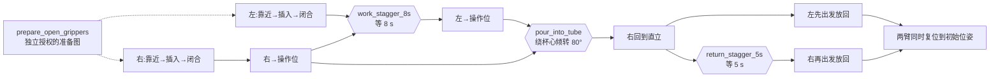

# 双臂化学仪器原子技能库

本库把现有烧杯、离心管实验拆成可独立调用的最小动作。位置和对象是参数；完整抓取、抓取后搬运、双臂准备是执行图配方，不注册成一个大技能。现有现场脚本继续保留。

## 1. 原子边界

一个原子技能只有一个动作目标和一个完成条件。参数校验、设备锁、控制器配置、轨迹预检、回包确认和到位等待是该动作的执行机制，不是供自然语言规划器自由插入的实验动作。

| 技能 ID（版本 1.0.0） | 最小动作 | 主要参数 | 完成依据 |
| --- | --- | --- | --- |
| `arm.move_joint` | 以关节运动到一个命名位姿 | `target_ref`, 可选 `source_ref`, `speed`, `grip_requirement`, `tilt_limit_deg` | 单次指令明确接受，原始关节反馈稳定到位 |
| `arm.move_linear` | 从一个命名起点直线移动到一个命名终点 | `source_ref`, `target_ref`, `speed`, `grip_requirement` | 单次指令明确接受，末端位姿稳定到位 |
| `gripper.set_position` | 夹爪执行一次开度动作 | `position`, `speed`, `allow_release`, 可选 `at_ref` | 舵机通信正常，开度反馈有行程并稳定，或已在目标附近 |
| `arm.rotate_about_pivot` | 围绕杯中心完成一次连续倾转 | `source_ref`, `tilt_deg`, `offset_mm`, `segments`, `speed`, `cp` | 整条队列接受，最后一个关节目标稳定到位 |
| `control.hold` | 在当前姿态保持指定时间 | `seconds` | 指定时间经过，期间未取消或失败 |

“靠近烧杯”“搬到操作位”是 `arm.move_joint` 的不同位姿参数；“插入夹持位置”是 `arm.move_linear`。开爪、合爪是同一个夹爪位置原语的不同参数。不要因为换手臂或换仪器复制实现。

倾倒内部的16段轨迹共同构成一次连续动作，不允许规划器把它们拆成16个可停顿节点。也不要把全部“靠近、插入、合爪、搬运”藏进一个原子调用。

## 2. 文件与接口

代码位于 `task_skills/chemistry/`：

- `catalog.json`：机器可读技能目录、中文别名、参数、前后条件、资源和证据语义。
- `profile.json`：本装置的设备绑定、六个命名位姿、标定来源和局限。
- `graph.schema.json`、`registry.py`、`graph.py`：JSON合同、白名单校验和执行图调用。
- `recipes.py`：已知实验流程的组合配方，不是自然语言模型。
- `driver.py`、`geometry.py`：五个原子的真机SDK实现及纯几何计算，不启动旧脚本的 `main()`，导入时不连接任何设备。
- `cli.py`：目录导出、配方生成、图校验、模拟与显式真机执行（本机调试入口，不是对外接口）。
- `dag.py`：把校验过的图渲染成 mermaid 文本。

配套还有 `examples/chemistry/`（可直接校验、模拟的示例图，含主图的 `.mmd`/`.dag.png`/`.dag.svg`）与 `tests/test_chemistry_skills.py`（86 项离线契约测试，不接触硬件）；对外接口的测试在 `tests/test_execution_gateway.py` 的 `ChemistryGatewayTests`。几何实现与现场脚本 `run_right_beaker_pour.py` 的 `waypoint_poses` 逐点比对一致（最大差 1.3e-12 mm / 0.0 deg），但它们仍是参考轨迹而不是真机测量。

```python
from task_skills.chemistry.registry import invoke, load_catalog, load_profile
from task_skills.chemistry.graph import execute_graph, validate_graph
from task_skills.chemistry.recipes import compile_recipe

profile = load_profile()
graph = compile_recipe("right_beaker_to_work")
checked = validate_graph(graph, profile)
# execute_graph(checked, driver, profile)
# invoke("arm.move_joint", "right", {"target_ref": "right.beaker.approach"}, driver, profile)
```

`driver` 显式注入。模拟结果标为 `simulated`；SDK执行完成标为指令/反馈证据。无论哪种，不能据此自动宣称仪器确实被夹住或液体确实倒入目标容器。

## 3. 当前装置数据

单位：位置毫米，姿态/关节角度；User0、Tool0；欧拉角顺序 `Rz Ry Rx`。完整六关节和证据在 `profile.json`。

| 位姿引用 | XYZ | RPY |
| --- | --- | --- |
| `left.tube.approach` | 80.2983, -385.8865, 109.2669 | -5.776, -90, 0 |
| `left.tube.grasp` | 15.9963, -385.8865, 109.2670 | -5.776, -90, 0 |
| `left.tube.work` | 52.8913, -578.6870, 136.9658 | 26.8229, -89.6266, 40.7961 |
| `right.beaker.approach` | -80.2983, -385.8865, 144.5468 | -5.776, 90, 0 |
| `right.beaker.grasp` | -22.5582, -385.8863, 144.5468 | -5.776, 90, 0 |
| `right.beaker.work` | -82.848034, -210.800574, 306.233254 | -0.904786, 89.819982, -52.195747 |

左臂为 `192.168.5.1 / COM8 / ID22`，右臂为 `192.168.5.2 / COM7 / ID21`。本装置开度255为张开，0为闭合目标。夹到物体后可能稳定在88、106等中间位置，这不是力值，也不是独立物体存在证据。

目录按现场脚本的**可执行常量**整理，右抓取点X取-22.5582；旧脚本开头注释中的-33.7782已经过期。配置是带日期和源文件哈希的快照，不会偷偷随着脚本修改而变更。重新示教后应显式更新配置并重新核验。

注意 `pour.offset_mm = [0, 0, 100]` 是 Tool0 局部偏移；直立搬运姿态下 ToolX 竖直，因此该 100 mm 落在水平面内，不是“杯心在正下方 100 mm”。这是现场给的估值（`offset_evidence = operator_approximation_not_calibrated`），不是标定结果。

已有现场日志证明旧脚本的抓取和到操作位运动执行完成，其中左WORK的最新证据是 `run_left_tube_grasp_20261015_104303_398_live.json`。它不等于新库驱动已经通过实机验收。右杯的100 mm中心偏移仍为估值；CP100下真实轨迹、液柱和落点尚未验收。两个仪器各自到操作位，也不等于杯口和管口已经完成相对接液标定。

`left.tube.work` 已于 2026-10-15 由操作员在点动面板上重新示教（读数截图存于 `artifacts/left-tube-work-20261015/`）：Y 方向 +5.41 mm、Z 方向 −34.21 mm、J2/J3/J4 各变约 1.1°/11.1°/10.1°。XYZ/RPY 与关节角取自同一帧屏幕，因此彼此自洽，但**两者都还没有被控制器重新正解、也没有在真机上到达过**；`fk_consistency_verified` 与 `reachability_verified` 均为 `false`。被替换的旧值连同 `delta_*` 记在该位姿的 `evidence.supersedes` 里，可回滚。受影响的节点是 `left_tube_to_work`（目标）与 `left_tube_return`（起点）两个。

## 4. 执行图合同

```json
{
  "schema_version": "1.0.0",
  "name": "left_tube_insert",
  "nodes": [
    {
      "id": "approach",
      "skill": "arm.move_joint",
      "arm": "left",
      "parameters": {"target_ref": "left.tube.approach", "grip_requirement": "open"},
      "depends_on": []
    },
    {
      "id": "insert",
      "skill": "arm.move_linear",
      "arm": "left",
      "parameters": {
        "source_ref": "left.tube.approach",
        "target_ref": "left.tube.grasp",
        "grip_requirement": "open"
      },
      "depends_on": ["approach"]
    }
  ]
}
```

图只接受注册技能、已登记位姿和有范围的参数，不接受Python、shell、模块名或条件表达式。校验包括未知字段、非法版本、非有限数、错误手臂引用、重复节点、悬空依赖、环和同臂未排序的资源冲突。`source_ref` 在预检里按推演状态核对，在执行期由直线移动与倾转重新观测真机状态（关节移动目前不做运行期重观测，靠到位等待保证）。

前驱全部成功后才能执行后继；一个动作失败后立刻停止整图并阻断不再分发的节点，不自动重试物理动作。底层执行器**按 DAG 真正并发执行**：每一个依赖已完成的节点都会被立即分发，因此两条臂确实会同时运动（见 4.2）。不同手臂不代表天然可并行或无碰撞——哪两个节点允许重叠是图作者用依赖关系表达的，本库不做碰撞判定。



这是逻辑依赖图，执行器按它并发调度。主图有两处刻意的错峰，方向相反：

- **去程**（08 `work_stagger_8s`）：右臂先出发把烧杯送到操作位，左臂在右臂**出发**后再等 8 s 才出发。等待节点与「先走的那个节点」共享同一个前驱（`right_beaker_close`），所以 8 s 从「右臂出发」起算，而不是从「右臂到达」起算——去程耗时本来就不确定，只有出发锚点才有意义。等待节点挂在左臂上，因为等待的是左臂。由于它同时依赖 `left_tube_close`，左臂出发一定不早于右臂出发后 8 s。
- **回程**（12 `return_stagger_5s`）：左右对称地反过来，左臂先出发放回离心管，右臂等 5 s 再出发。

两段之后各有一个屏障：`19 left_arm_home` 与 `20 right_arm_home` 同时依赖 `left_tube_retreat` 和 `right_beaker_retreat`，因此两条臂的复位是同时开始的，不是一前一后。

倾倒配方独立要求右杯已经直立位于 `right.beaker.work`，不包含开头150 mm平移，也不自动返回直立。

### 4.1 张开夹爪必须是单独的、明确授权的准备步骤

驱动对任何"把夹爪往开的方向"的命令都要求节点带 `allow_release=True`，因为开度反馈无法证明夹爪里没有东西。因此**任务图里不放张开动作**：一个 `allow_release=False` 的张嘴节点在真机上必然被拒，属于不可满足节点（实测：左夹爪读数 253、命令 255，任务停在第一个节点）。

约定：先用 `prepare_open_grippers`（两个节点，左右各一次，均带 `allow_release=True`）把夹爪张开，确认现场无夹持物；随后所有任务图都**假定夹爪已张开**，只允许闭合（`position` 低于开度下限）与明确授权的释放（`allow_release=True`）。`validate_graph` 会把违反这条的图直接拒掉，不再等到真机上才失败。

### 4.2 并发调度：DAG 允许的同时，就必须真的同时

调度器维护"依赖已全部完成"的就绪集合，每个就绪节点立刻提交执行，绝不为另一条臂空等。**同臂互斥不是调度器加的，而是校验器保证的**：`validate_graph` 要求任意两个同臂节点之间必须有依赖路径，因此同臂节点不可能同时就绪，同一时刻每条臂最多只有一个节点在下发指令。调度器另有一条防御性检查：若真出现同臂两个就绪节点就立刻报错拒发，而不是赌一把。

两条臂能同时跑，靠的是每一层都独立：`DobotApiDashboard`/`DobotApiMove` 各自持有自己的 socket 和内部锁；本库另加一把会话锁把"取设备租约"这一步串行化——租约是整台机器一份，两条臂各自去抢会让其中一条在空着的机器上失败；再给每条臂一把命令闸，保证一次命令和它的回读不会被切开。

报告给的是实证而不是复述图结构：`execution.mode = "concurrent_dag"`、`execution.workers`、每个节点的 `started_after_seconds`/`finished_after_seconds`（相对整图起点），以及 `execution.simultaneous_pairs`——**按实测墙钟窗口求交**得出的重叠节点对。同臂节点不可能重叠，所以这里的每一对都是两条不同臂的真实同时运动。窗口长度为零的节点不会和任何东西重叠，所以模拟驱动默认给每个节点加一小段停留（`--simulate-seconds`，默认 0.2 s），并**严格按 `control.hold` 声明的秒数睡眠**：没有机械臂时，`right_beaker_to_work` 与 `work_stagger_8s`、`left_tube_to_work` 与 `right_beaker_return` 的重叠、以及两臂复位的同步，都能直接从报告时间戳上看出来。测试里有一条断言"任意一对重叠节点不得同臂"，一条逐边断言"没有任何节点早于它的任一依赖完成就开始"，一条断言错峰窗口内另一条臂确实在动，还有一条把调度器退回单线程就立刻失败的用例。

## 5. 命令与后续自然语言接入

在仓库根目录，用已安装硬件依赖的解释器运行；前三项不会连接机械臂：

```powershell
& 'C:/software/anaconda3/envs/dobot-xtrainer/python.exe' -m task_skills.chemistry.cli catalog
& 'C:/software/anaconda3/envs/dobot-xtrainer/python.exe' -m task_skills.chemistry.cli plan dual_prepare
& 'C:/software/anaconda3/envs/dobot-xtrainer/python.exe' -m task_skills.chemistry.cli validate examples/chemistry/dual_prepare.json
& 'C:/software/anaconda3/envs/dobot-xtrainer/python.exe' -m task_skills.chemistry.cli run examples/chemistry/dual_prepare.json
```

`run` 默认只模拟。现场执行必须显式加 `--live`，并在只读预检后确认。只读预检与部分运动原子已在真机跑通（见 §7 末的证据等级），但 `completed_command_trace` 只到"指令被接受、反馈到位"这一层，不等于物理成功。初始图中的开度节点不默认授权释放已持物体；需要释放时必须显式提供 `allow_release`，并由现场确认支持条件。

把两条臂送回标定初始位姿用独立子命令（它**不是**原子技能，也不出现在任何图里）：

```powershell
& 'C:/software/anaconda3/envs/dobot-xtrainer/python.exe' -m task_skills.chemistry.cli home --live --output run_home_20261015.json
& 'C:/software/anaconda3/envs/dobot-xtrainer/python.exe' -m task_skills.chemistry.cli home --live --arms right
```

不带 `--live` 时该子命令直接以退出码 2 拒绝，不会因为口误而驱动机械臂。`--arms` 按给出的顺序逐条归位，便于操作员在两条臂之间中断；一条臂失败不会取消另一条，报告里逐臂给出成功/失败与原因。

自然语言规划器以后只需：读取目录 → 绑定对象与命名位姿 → 选择最小动作 → 补充前后依赖 → 输出上述JSON → 通过静态校验和现场预检 → 调用执行器。自然语言不直接生成关节值、随意改帧或把一条倾倒轨迹拆碎。

本库没有冒充通用自然语言理解器。对外**只有一个接口**：仓库既有的执行网关
`task_skills/run_gateway.py`。化学原子作为第二个技能组 `dobot.*` 挂在同一个
`RuntimeExecutionPackage 2.1 / graph_version 0.1` 信封下，与既有的 `embodied.pick/place`
并列发布，不新起第二个 HTTP 服务。

### 5.1 接口调用（HTTP）

对方把原子技能执行图 POST 过来时，起的是既有网关（在仓库根目录）：

```powershell
python -B -m task_skills.run_gateway --mode mock --port 8080 --data-dir ./gateway-data/mock-chem
```

`--mode mock` 不碰机械臂；真机联调用 `--mode live --allow-live`（Windows 限定，且需
`DOBOT_GATEWAY_TOKEN`，见 `docs/execution-api/README.md`）。联调最省事的写法是
`POST /v1/execute-graph`：**请求体就是这个运行包本身（不用套 `graph`），也不需要任何
幂等键**，每次请求都新建一个执行。要网络重试幂等时改用
`POST /v1/execute-graph/idempotent`，那条路由必须带 `Idempotency-Key`（或包里的
`request_id`），包本体同样可以不带外壳：

```powershell
python -B -m task_skills.gateway.demo_client --package docs/execution-api/examples/runtime-chemistry-beaker-pour.json
```

技能 ID 是化学原子 ID 加 `dobot.` 前缀：`dobot.arm.move_joint`、`dobot.arm.move_linear`、
`dobot.arm.move_to_home`、`dobot.gripper.set_position`、`dobot.arm.rotate_about_pivot`。
`control.hold` **不注册成技能**，直接用信封自带的 `wait` 节点（`duration_s`）。

参数、默认值、范围与位姿白名单不在网关里重写一遍：网关转发给
`task_skills.chemistry.registry.normalize_parameters` 校验，与 `cli validate` 是同一个校验器。
一份包只允许一个技能族（`embodied.*` 或 `dobot.*`），混用直接 422。化学节点不参与
`embodied.pick/place` 的对象状态机（`held`/`location` 描述的是场景里的 A/B，不是工具）。

真机时化学驱动独占机械臂会话（设备租约、`ClearError`、`EnableRobot`、速度、`Tool0`/`User0`
都由它持有），网关只转发、不另开一条连接。因此化学包在 live 下的开始闸门是化学驱动的只读
预检（按拓扑序对"从一次真机读数推演出的逐臂状态"逐节点核对），**不是** embodied 家族那条
"两臂必须已在示教 home"的要求；跑完仍由网关收尾并发归位。

可提交的示例见 `docs/execution-api/examples/runtime-chemistry-beaker-pour.json`
（20 节点 / 24 边，由 `examples/chemistry/right_beaker_pour_into_left_tube.json` 经
`task_skills.gateway.chemistry.to_runtime_package` 机械生成，测试逐字节钉住两者一致）。
`docs/execution-api/README.md` 有完整路由表、字段与联调命令。

## 6. 运行与证据规则

设备锁、远程模式、使能、速度、CP设置和清理属于会话。使用现场与旧网关的共享锁路径互斥，不按“一个技能一个独立脚本”争用串口。外部不遵守锁的手动点动或串口程序仍需关闭。

每次运动先读真实状态和严格有限值，核验目标与路径；扫描后起点发生变化则拒绝。只有一条完整、与本次参数对应的成功ACK可认作接受，空回包、超时、错echo或多帧都不能盲重发。异常停止队列并保留夹持，不自动松爪、回零或禁用机械臂。

夹爪闭合输出位置证据，不输出 `object_held_confirmed=true`。CP过渡后的真实几何没有官方误差上界，关节直线插补扫描仅是未混合参考轨迹核验。结果分别保留接受、完成、模拟/指令反馈级别和真实物理成功字段，方便规划器按证据处理，而不是把“函数返回”当实验成功。

## 7. 真机驱动合同（`driver.py`）

`LiveDriver` 构造不打开任何连接、不写文件、不导入串口库；只有 `allow_live=True` 且注入的确认回调返回 `True` 时才可能动作。`cli run --live` 会先跑完整只读预检，再要求输入大写 `YES`。

- `preflight` 只读：可读 `GetAngle`/`GetPose`/`RobotMode`、请求 `InverseSolution`/`PositiveSolution`、打开 30004 广播；不清错、不使能、不设速度或坐标系、不运动、不碰夹爪，也不获取设备租约。dashboard 返回 `-2`（非TCP远程）或 30004 全零都判为不可用，不算通过。
- 预检按节点复核：目标位姿属于本臂；`source_ref`/`at_ref` 用**推演状态**核对——预检为每条臂维护一份模拟状态，初值取真机读数，按拓扑序在每个节点通过后推进（关节/直线移动落到目标位姿，倾倒落到最后解出的那个航点，夹爪与等待不变）。这样 13 个带起点要求的节点各自在其真正的执行时刻被核对；若改成对跑之前那一张冻结快照逐个核对，等于要求同一条臂同时停在三个教示姿态上，**任何可达起始构型都不可能通过**。声明的约束依然生效：某节点引用的起点若前面没有任何节点到达，推演状态同样到不了，预检照样拒绝。真实到位仍由执行期的到位等待负责，推演不替代它。笛卡尔目标做整姿态 IK+FK 回环（≤0.5 mm / ≤0.5 deg）；直线段扫 21 点并要求 J5 奇异余量；倾倒扫全部 17 个航点、每点用上一点做 IK 种子，任一点不可解或夹片中面离开水平都**拒绝整张图**，不做静默缩短。
- 运动帧只接受“与本次请求完全一致的 status 0 回显”。空回包、超时、错 echo、多帧都不是成功，不盲目重发；仅 `-10000`/`-2` 允许一次重发并全部记录。30003 的 0.05 s 收包窗口在本驱动内被显式放宽，而不是把首次空读当答案。
- 夹爪：目标比当前更开（释放）默认拒绝，必须显式 `allow_release=True`；因此准备夹爪要单独成图（见 4.1）。当前开度低于 250 时继续闭合只记录为注意事项，不额外新增合同里没有的前置条件——但这意味着该次闭合不能当作“对张开夹爪的首次抓取”。开度只作为位置证据，方向由“是否有行程”判定而不是写死符号。
- 会话：设备租约 → `ClearError` → `EnableRobot` → 速度/加速度 → `Tool0`/`User0`；单个原子从不让机械臂归位、从不 `DisableRobot`、不动另一条臂。已开始夹持后的任何失败只发 `StopScript`，保持使能与夹持，不松爪。
- 归位是同一条会话上的独立工具 `LiveDriver.home(arms, profile)`，走的是与原子完全相同的会话和收包规则，只是目标为 `layout.physical_nova_home_degrees`（左 `(90,0,90,0,-90,-90)`，右 `(-90,0,-90,0,90,90)`，与 `run_graph.py` 的收尾归位、`dobot_adapter.move_to_safe_pose` 同一常量来源）。它**不注册为原子、不进目录、不进配方、不出现在任何 DAG 节点里**：归位是操作员的复位动作，而不是任务的一步。归位是关节空间 `JointMovJ`，因此不声明任何中间笛卡尔路径；不碰夹爪、不禁用机械臂，夹爪里夹着的东西照旧夹着；两条臂逐条执行，一条失败不取消另一条。
- 每条臂在归位前先做一次**只读探测**：关节落在标定 home 的 `ARRIVAL_TOL_DEG`（0.5°）以内、且 `RobotMode` 为 5，则该臂记 `skipped` 并**完全不发指令**——不使能、不清错、不配置速度、不取设备租约。这个探测走 dashboard-only（与预检同一条只读路径，不带运动 socket），用的目标常量与容差和到位等待完全一致，所以"已经在位"和"刚刚到位"是同一把尺子。只有确实不在 home 的臂才会进入完整会话并运动。这样一条图里已自行归位的臂（例如 `left_arm_home`/`right_arm_home` 结尾的包）在网关收尾时不会为了凑动作再动一次。
- 速度有三个不同的量，不要混着改：平移/关节/归位原子（`arm.move_joint`/`arm.move_linear`/`arm.move_to_home`）默认 `speed = 20`，同一个数一起写进 `SpeedFactor` 与对应的 `SpeedJ|SpeedL`/`AccJ|AccL`；倾倒原子 `arm.rotate_about_pivot` 单独保持 `speed = 15`（2026-10-15 按操作员要求：其他都提速，倾倒保持原速）；夹爪原子默认 `speed = 10`，那是 Feetech 舵机的速度档，不是关节速度百分比。目录、`registry.py` 硬编码默认值、`graph.schema.json` 与 `profile.json`（`arms[*].speed_default` 供归位用，`pour.speed` 与倾倒原子同为 15）四处必须同时改，`tests` 里有一条测试专门把目录声明和代码实际应用值钉在一起，改一处会直接失败。
- `execute_graph` 在**所有**出口（成功、确认被拒、预检失败）都会调用驱动的 `close()`；驱动借此释放共享租约、关闭 socket 与夹爪串口。只做校验的驱动没有 `close()`，因此该钩子按“是否具备”触发。

证据等级（2026-10-15 真机记录，逐层分开）：

- **只读预检**：已在真机跑通。两臂均在 TCP 远程模式、mode 5，逐节点复核通过，`hardware_commands_sent: false`。
- **夹爪授权闸**：首次带确认的运行（12:58）停在第一个节点 `left_tube_open`——左夹爪读数 253、命令 255，被拒绝，**未产生任何运动指令**。这就是 4.1 被实测逼出来的证据。
- **准备步骤**：13:12 `prepare_open_grippers` 返回 `completed_command_trace`（只动夹爪，没有运动原子）。
- **运动原子**：13:19 的任务图跑到第 10 个节点 `pour_into_tube`，说明前 9 个节点（两臂 approach/insert/close、`right_beaker_to_work`、`beaker_settle_5s`、`left_tube_to_work`）在真机上完成了；`pour_into_tube` 因连续 12 s 无进展失败（27.66 mm / 5.62 deg，RobotMode 3），**根因未定**，后续 7 个节点未执行。13:33 单臂配方 `right_beaker_pour` 返回 `completed_command_trace`：17 段 `MovL`，末航点到位 0.0 mm / 0.0 deg。
- **网关收官归位**：2026-10-15 17:20（CST）的一次 live 运行里，包内 20/20 节点全部成功（含 80° 倾倒与两臂归位原子），随后网关的收尾归位抛 `FINAL_HOME_FAILED`（`RuntimeError: homing was not confirmed on site`），整次执行被记为 `failed`，并按设计隔离 rig（事件 43–47，`execution-02284b12436c464698998ee3c78b794d`）。原因是网关构造驱动时没有注入确认。此后网关把 live 请求本身视为现场授权（见 `gateway/chemistry.py`），并加上"已在 home 即跳过"的只读探测；**这两项改动目前只有离线证据，尚未在真机复跑**。
- **仍未验收**：`home` 子命令尚未在真机跑过；`physical_success_verified` 全程为 `false`；倾倒液体流、杯口位置与夹持力都没有标定。更早的现场日志属于旧脚本，不能算新库的运动验收。
